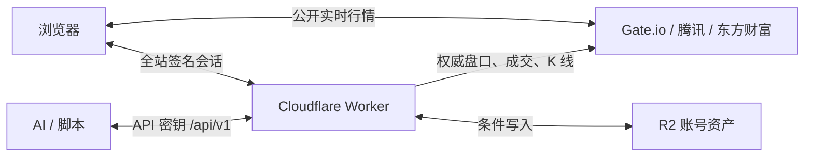

# GAME.INC.RE

Static game collection with accounts and likes, published at https://game.inc.re/ by the Cloudflare Worker `inc-games`.

- Repository: https://github.com/mumuhaha487/opus_game
- Production branch: `main` (the repository default branch)
- Cloudflare Worker: `inc-games` (`wrangler.jsonc`): static assets from `dist/` plus the API in `worker.js` → `server/`
- Workers Builds: build command `node build.mjs`, deploy command `npx wrangler deploy`, root directory `/`
- Custom domain: `game.inc.re` (attached to the Worker; the zone serves proxied hostnames over IPv4 only)
- Node.js: 22 or newer; the build installs nothing.

## Layout

| Path | What it is |
|---|---|
| `index.html`, `hub/` | 汇总页：热门轮播、按分类展示全部游戏、点赞、账号对话框 |
| `hub/catalog.js` | 游戏目录：每款游戏的分类、封面、介绍、角色、按键说明 |
| `entropy-blade/` | 《熵刃》像素横版动作肉鸽 |
| `tbmh/` | 《悬赏怪物猎人》像素挂机放置 RPG（策划文档见 `tbmh/README.md`） |
| `whiteline/` | 《白线以内》像素规则拼图 |
| `edge-acres/`, `stack-realm/`, `iron-line-1917/` | 《边角农场》《叠叠乐大陆》《铁血防线》：在各自的项目里用 `npm run build:site` 构建，再用 `node _work/xz/sync-games.mjs` 复制进来（只复制，不在这里改） |
| `worker.js`, `server/` | Worker 入口与接口：账号、云存档、点赞（`/api/*`，其余请求交给静态资源） |
| `wrangler.jsonc` | Worker 配置：静态资源目录、R2 绑定、自定义域名 |
| `tools/` | 像素字体子集工具 |
| `build.mjs` | 发布检查 + 复制站点文件 + 资源版本号 |

## Updating the Site

Edit the site, run `node build.mjs`, then commit and push to `main`.
Workers Builds runs `node build.mjs` and `npx wrangler deploy` for each push to `main`.
`deploy.ps1` does the same build and deploy by hand (needs `CLOUDFLARE_API_TOKEN` / `CLOUDFLARE_ACCOUNT_ID` in the environment).

```powershell
node build.mjs
git add -A
git commit -m "Update games"
git push origin main
```

`build.mjs` checks the release before copying anything and stops with a list of problems:

- every catalog game has a known category, an entry page under a shipped folder, a cover and its cast images;
- every game with cloud saves (`server/games/`) is on the hub;
- the TBMH save cleaner (`server/games/tbmh.js`) knows every id that `tbmh/js/data.js` can write;
- the hub font and the TBMH font cover every character their pages draw.

The builder then copies only the public site files into `dist`, versions asset URLs
with a content hash and sets `window.BUILD`. Build output, archives, local work folders
and credential files are ignored by Git.

## Cloudflare 免费额度

站点跑在 Workers 免费版上，额度这样计算（以 Cloudflare 文档为准，2026-10 核对）：

- **静态文件免费、不限量**：请求的路径在 `dist/` 里有对应文件时，由静态资源直接返回，不运行 Worker，不计入每天 10 万次请求。
  所以 `wrangler.jsonc` 不开 `run_worker_first`，也不开 Workers Caching（`cache`）：后者开启后连缓存命中的静态文件也按请求计费。
  `build.mjs` 检查这两项。
- **计费的是 Worker 请求**：所有 `/api/*`，以及任何不存在的路径（浏览器和爬虫自己会要的 `/favicon.ico`、`/robots.txt`、
  `/apple-touch-icon*.png` 已作为静态文件放在根目录）。每天 10 万次（UTC 0 点重置），每次请求 CPU 10 ms。
- **R2**：每月 100 万次写类操作（Class A：put、list、delete）、1000 万次读类操作（Class B：get、head）、10 GB 存储。
- **浏览器缓存**：页面 HTML 每次打开都向服务器确认（默认 `max-age=0, must-revalidate`）；其余静态文件的地址都带 `?v=`，
  `_headers` 让浏览器缓存一年。图片、字体、CSS 和不导入其它模块的脚本用自身内容的哈希，没改动的文件发布后地址不变、继续用本地缓存；
  互相导入的 ES 模块用整站版本号。`build.mjs` 改写 HTML、CSS `url()`、JS `import` 和目录里的图片路径，并检查不留没有版本号的引用。

省请求的约定：账号状态在同一个标签页里 10 分钟内只确认一次；游戏云存档存档后最多每 2–3 分钟上传一次（页面隐藏时立即上传），
已知版本时直接 PUT，冲突由 409 带回云端存档；交易状态与点赞的后台刷新不快于每 5 分钟、页面隐藏时暂停；
存档写入限流用免费的 Workers 限流绑定（`SAVE_RATE`），不占 R2 操作。`node _work/cf-budget/usage.mjs 7` 查看最近 7 天的实际用量。

## 汇总页

- **首页**：游戏馆与交易所两扇门；顶部导航按滚动位置高亮首页 / 游戏馆 / 交易所。
- **游戏馆**：全部游戏卡片，可按分类筛选、搜索名称与标签、按最新 / 最热排序。
  热度 = 近 7 天点赞 × 2 + 总点赞，上线两周内的新作额外 +10；点赞数在切回页面和登录 / 退出时刷新。
- **详情**：封面、角色、介绍、数据、平台与按键。
- **交易所预览**：指数与币价、签到和资产概览，数据直连公开行情。

### 加一款新游戏

1. 把游戏放进自己的文件夹，入口是 `<文件夹>/index.html`，并把文件夹名加进 `build.mjs` 的 `siteFiles`。
2. 在 `hub/catalog.js` 的 `GAMES` 里加一条：`id`、`no`、名称、`href`、`category`、标签、`released`、封面、
   介绍、`facts`、`cast`、`platforms`、`keys`。`category` 必须是 `CATEGORIES` 里的一项
   （动作、放置、角色扮演、策略、解谜、休闲）；需要新分类时先在 `CATEGORIES` 里加。
3. 需要云存档时：在 `server/games/` 加一个导出 `clean` 的白名单清洗模块并登记到 `index.js`，
   游戏页面加载 `../hub/account-core.js`，在 `hub/account-ui.js` 的 `HUB_GAMES` 加存档摘要。
4. 重新生成汇总页字体（见下文），运行 `node build.mjs`。

点赞接口直接读取 `hub/catalog.js` 的 id，新游戏上线即可被点赞。

## 点赞

| 接口 | 说明 |
|---|---|
| `GET /api/likes` | `{ day, games: { id: { total, week } }, mine: { guest: [...], user: [...] \| null } }` |
| `POST /api/like/<id>` | 点赞；已点过返回 409 `already_liked`，未知游戏 404 |

- 每个网络（IP）每天每款游戏可以点一次；登录账号后，账号每天每款游戏还能再点一次，两份额度互不影响。
  IPv6 按 /64 网段计算。日期按北京时间。
- 每日标记存在 `rl/like/<日期>/{ip|u}/<HMAC>.json`：IP 和账号 id 都只以 `AUTH_SECRET` 的 HMAC 形式出现，
  R2 桶已有的 `rl/` 一天生命周期规则会自动清理，不需要新的 Cloudflare 资源或绑定。
- 累计数存在 `likes/summary.json`（总数 + 最近 14 天每日数）。所有写入都是 R2 条件写入（etag），并发时自动重试；
  计数写入失败会退回当日标记。点赞接口另有每 IP 每 10 分钟 40 次的限流。

**运行在 Workers 上：** 站点从 Pages 迁到了 Worker `inc-games`（2026-10-11），沿用同一个 R2 桶与同样的 `AUTH_SECRET` / `PW_PEPPER`，
账号、会话、存档与点赞数据原样保留。旧的 Pages 项目 `inc-games-git` 已停止自动构建，最后一次部署留在 pages.dev 上作为回退。

## 账号与云存档

GAME.INC.RE 的账号在所有游戏通用。在汇总页的账号对话框、熵刃标题菜单「账号战绩」、悬赏怪物猎人「设置」或白线以内「存档」里注册、登录和退出。
白线以内的存档是一份文档：自动存档、三个手动存档位与图鉴，登录后同步；两台设备都改过时按条目合并（图鉴取并集，每个存档位保留较新的一份）。
边角农场、叠叠乐大陆和铁血防线共用 `hub/game-cloud.js`：游戏每次本地存档后把一份压缩存档文档 `{ v, game, at, meta, gz }` 交给它，
它在账号缓存里记下并定时上传（按已知版本直接 PUT，冲突时服务器回 409 并附上云端存档）；两台设备都改过时弹窗让玩家选保留哪一份。
`gz` 是完整存档的 gzip + base64，服务器检查格式、长度和 gzip 头尾（解压后 1 字节到 8 MB）；`meta` 是几项进度数字，账号面板摘要与排行榜都读它，`GET /api/saves` 的列表里也只带 `meta`。
`meta` 按游戏数据检查后才保存：不超过游戏里的总数（图鉴、地图、任务、配方、勋章），收获、页面时长、月亮、任务、战斗与战役胜利的增长不超过这段时间能达到的上限；数字变小照常接受（两台设备都改过时可以留下本机较旧的一份）。
增长从存档记录里的锚点量起（锚点只存在服务端）：锚点满 60 秒才移到新存档，连续快速上传共用一份额度。
排行榜 `GET /api/board/<game>` 公开可读（缓存 30 秒），成绩由游戏模块的 `board(save)` 从清洗后的云存档算出，每个账号保留最好的一次，存前 50 名。
排行榜成绩来自玩家自己的云存档，服务器只拒绝快过游戏上限的进度，成绩并不防篡改。账号第一次上传某款游戏时，游客进度可以整份带进账号：
没有排行榜的熵刃和悬赏怪物猎人不做时间检查，只查结构和绝对上限；有排行榜的三款按已经过了 30 天检查。
`hub/account-core.js` 提供共享的认证请求、账号指针、缓存键、旧键迁移和退出流程；`hub/account-ui.js` 显示账号与游戏存档。
未登录时各游戏使用浏览器本地存档，登录后各游戏通过同一账号访问各自的云存档。

账号接口由同站点的 Worker 提供：`worker.js` 把 `/api/*` 交给 `server/api.js`，`server/` 实现认证、请求校验与点赞，
`server/games/` 的 `GAMES` 注册表按游戏选择白名单清洗函数。`GET /api/saves` 逐个读取已注册游戏，返回当前用户已有的云端存档。
R2 绑定名为 `ACCOUNTS`，生产桶为 `game-inc-accounts`，本地预览用 `game-inc-accounts-preview`。
其余路径由 Worker 静态资源直接返回（`_headers` 同样生效）。
全站账号指针是 `gameinc_profile_v1`，游戏缓存使用 `gameinc_save_<game>_<小写用户名>_v1`。
退出会尝试上传脏缓存，仍未同步的进度留在这台设备上，下次登录同一账号后由对应游戏合并上传。

从零搭建：

1. 在 Cloudflare 账号内创建上述两个 R2 桶，保持 r2.dev 访问关闭、自定义域名列表为空。
2. 给两个桶添加前缀为 `rl/` 的生命周期规则，`deleteObjectsTransition.condition`
   为 `{ "type": "Age", "maxAge": 86400 }`，启用后 GET 核对。
3. `wrangler.jsonc` 已声明 `ACCOUNTS` R2 绑定与自定义域名 `game.inc.re`；第一次 `npx wrangler deploy` 会创建 Worker。
4. 生成两个不同的 32 字节密码学随机数（base64url 编码），用 `npx wrangler secret put AUTH_SECRET` / `PW_PEPPER` 写入 Worker，
   生产值备份到被忽略的 `.env.accounts`。`PW_PEPPER` 更换后所有已注册密码都会失效；
   `AUTH_SECRET` 更换后已有会话需重新登录，当天的点赞标记也会重新计算。
5. 在 Worker 的 Settings → Builds 连接 GitHub 仓库：分支 `main`，构建命令 `node build.mjs`，部署命令 `npx wrangler deploy`，根目录 `/`。

本地联调在被忽略的 `.dev.vars` 中设置测试用的 `AUTH_SECRET`、`PW_PEPPER`：

```powershell
node build.mjs
npx --yes wrangler@4 dev
```

接口通过同源 `/api/*` 访问；POST / PUT 请求带同源 `Origin` 与 JSON 媒体类型。
密码先经 `PW_PEPPER` 的 HMAC-SHA256，再进行带随机盐的 PBKDF2-SHA256（目标迭代次数 100000，用户记录保存实际次数）。
会话通过签名 Cookie 保存，属性为 `__Host-gsid`、Secure、HttpOnly、SameSite=Lax、Path=/，有效期 30 天。
注册限制按网络计算（IPv4 地址，IPv6 按 /64）：每小时最多成功注册 2 个、24 小时最多 5 个，只计成功的注册；
另限每小时 20 次注册请求。登录只计失败：同一 IP 一小时内失败 30 次以内只提示“用户名或密码错误”，
之后提示“登录失败次数过多，请稍后再试。”；同一账号一小时累计失败 100 次（防多 IP 轮换猜密码）同样拦截。都按滑动一小时 / 24 小时计算。
名额在创建账号、校验密码之前用条件写预占，并发请求也越不过上限；注册没能创建账号、登录密码正确时退回预占的名额。
注册、存档与点赞使用 R2 条件写入，限流键经过 SHA256，`rl/` 临时数据一天后清理。存档上传数据按白名单清洗，
再按游戏规则检查进度增长（时间按距上次云存档的服务端时间计，首次上传见上文）；检查不通过返回 422，云端进度保持原样。桶保持私有。
清洗后的单份存档默认上限 64 KB，游戏模块可以导出更大的 `MAX`（悬赏怪物猎人约 176 KB，只接受第三版存档）。

## 像素字体

汇总页和悬赏怪物猎人都只嵌入用到的 Fusion Pixel 字形。修改了页面文字后重新生成：

```powershell
npm install --no-save --prefix tools/.deps subset-font
node tools/hub-font.mjs          # hub/fusion-pixel-12.woff2
node tools/game-font.mjs tbmh    # tbmh/js/font.js
node build.mjs
```

字体源是熵刃内嵌的同版本 Fusion Pixel（`entropy-blade/js/fontdata.js`）；缺字时工具会列出缺的字符并停止。
生成工具的依赖只安装在被忽略的 `tools/.deps/`，站点构建保持零依赖。

## 模拟交易所

入口为 `/trade/`，复用全站账号，资产保存在 R2 的 `trade/<uid>.json`。五个账户：钱包（USD）、加密现货（USDT）、
USDT 永续合约（逐仓、单向持仓）、A 股（CNY）、美股（USD）。任意两个账户可直接划转：USD / USDT 1:1，
涉及人民币时按实时 USDCNY 换汇并收 0.2%（人民币买美股要先划到美股账户换成美元）。

展示行情由浏览器直连公开数据源，不占 Worker 额度；成交只用 Worker 端取得的权威价格：

| 市场 | 展示（浏览器） | 成交与结算（Worker） |
|---|---|---|
| 加密现货 / 合约 | Gate.io WebSocket / REST，Binance 镜像作展示备用 | Gate.io 盘口（WebSocket 优先，REST 备用）、逐笔与 K 线 |
| A 股 | 东方财富与腾讯互为备用 | 腾讯五档撮合；挂单按东方财富分钟 / 逐笔结算，腾讯备用 |
| 美股 | 腾讯 qt / sqt | 新浪实时成交价，腾讯在同样新鲜时备用；挂单按腾讯分钟结算 |



| 网页接口 | 用途 |
|---|---|
| `GET /api/trade/state` | 先惰性结算，返回全部账户、签到、当前委托和近期记录 |
| `GET /api/trade/history?kind=orders|trades|ledger&market=wallet|spot|futures|ashare|usstock` | 有上限的历史 |
| `POST /api/trade/checkin` | 每周签到 |
| `POST /api/trade/transfer` | 账户划转 |
| `POST /api/trade/{spot,futures,ashare,usstock}/order`、`…/cancel` | 下单与撤单，clientId 去重 |
| `POST /api/trade/cancel-all` | 按市场、交易对撤销全部委托 |
| `POST /api/trade/futures/{leverage,tpsl,margin,close}` | 合约杠杆、止盈止损、保证金与平仓 |
| `POST /api/trade/ashare/watch` | A 股自选 |

API 密钥在交易所账户面板或 `/developer/` 创建，`/api/v1/*` 覆盖网页上的全部交易操作，另有市场清单、盘口与 K 线；
接口说明见 `/developer/`，创建密钥时附带给 AI 的完整提示词。

市价单吃对手盘口，深度不足时部分成交并取消余量。限价单先冻结资金，立即可成交部分吃盘口记 Taker，
余量等待下单之后的真实成交或完整 K 线命中，再按限价成交记 Maker。现货 Maker / Taker 都是 0.1%，
合约 Maker 0.02% / Taker 0.05%；A 股收佣金（最低 5 元）、过户费和卖出印花税；美股佣金 0，卖出收 SEC 费与 FINRA TAF。

惰性结算跳过下单之前的数据，首尾不完整分钟查逐笔，历史按 1m / 1h / 1d 分段。
金额内部使用 18 位 BigInt：入账向下、出账及费用向上取整。R2 使用 etag 条件写并最多重试四次；
每次 Worker 调用最多 30 次上游 fetch，预算不足时返回 partial 并记录进度，前端随后继续同步。

签到按周计算：北京时间每周一 00:00 开始新一周，本周第 1–7 次签到依次奖励 **20、25、30、35、40、45、50 USD**，
不要求连续，奖励发到钱包。首次创建交易文档余额为 0。

### 美股

入口 `#/usstock`（列表）与 `#/us/<代码>`（个股），用美元结算，账户为 `usstock`。

- 名单：`trade/js/usstock/universe.js`（浏览器与服务端共用）；交易日历含纽交所假日、提前收盘和夏令时，在 `trade/js/usstock/calendar.js`。
- 成交价：市价单与可立即成交的限价单使用新浪实时成交价（数据时间 30 秒内、最后成交 3 分钟内），
  腾讯在同样新鲜时作为备用；都不新鲜时返回 503 `market_stale`。
- 挂单：只用委托之后完整结束的腾讯分钟数据，触价按限价成交；盘外委托排入下一交易时段，
  开盘第一根已越过限价时按该价成交；收盘时未成交部分过期并解冻。
- 规则：整股、T+0、只卖持仓、限价须在参考价 ±50% 内（防手误）。

### 请求额度

Cloudflare 免费版每天 100,000 次 Worker 请求，静态资源不计入。登录且可见的交易所页面按需轮询 state，
单账号限流为每分钟 180 次请求 / 40 次 POST；每把 API 密钥每分钟 GET 10 次、POST 10 次，每天 1500 次，
每个账号每天 3000 次（北京时间重置）。每日额度按批次合并计数（每 10 次或 30 秒写一次，剩余 100 次以内逐次计数），
是近似值，分布式调用会有少量计数误差。

### 本地开发

在被忽略的 `.dev.vars` 中设置独立测试用 `AUTH_SECRET` 与 `PW_PEPPER`，使用本地 R2，不连接生产存储：

```powershell
node tools/hub-font.mjs
node build.mjs
npx --yes wrangler@4 dev --local
```

图表库是 `trade/vendor/` 中原样复制的 Lightweight Charts 5.2.1，保留许可证和 attribution。
构建不安装依赖，额外检查市场清单、vendor 版本与纯函数自检（包含 1000 组舍入守恒检查）。

## Optional Manual Deployment

`deploy.ps1` builds the same site and uploads it with Wrangler. It requires
`CLOUDFLARE_API_TOKEN` and `CLOUDFLARE_ACCOUNT_ID` in the environment.
Never put credential values into tracked files.
