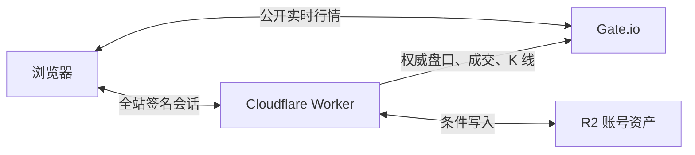

# GAME.INC.RE

Static game collection with accounts and likes, published at https://game.inc.re/ by the Cloudflare Worker `inc-games`.

- Repository: https://github.com/mumuhaha487/opus_game
- Production branch: `main` (the repository default branch)
- Cloudflare Worker: `inc-games` (`wrangler.jsonc`): static assets from `dist/` plus the API in `worker.js` → `server/`
- Workers Builds: build command `node build.mjs`, deploy command `npx wrangler deploy`, root directory `/`
- Custom domain: `game.inc.re` (attached to the Worker; the zone serves proxied hostnames over IPv4 only)
- Node.js: 22 or newer; the build installs nothing.

## Layout

| Path | What it is |
|---|---|
| `index.html`, `hub/` | 汇总页：热门轮播、按分类展示全部游戏、点赞、账号对话框 |
| `hub/catalog.js` | 游戏目录：每款游戏的分类、封面、介绍、角色、按键说明 |
| `entropy-blade/` | 《熵刃》像素横版动作肉鸽 |
| `tbmh/` | 《悬赏怪物猎人》像素挂机放置 RPG（策划文档见 `tbmh/README.md`） |
| `worker.js`, `server/` | Worker 入口与接口：账号、云存档、点赞（`/api/*`，其余请求交给静态资源） |
| `wrangler.jsonc` | Worker 配置：静态资源目录、R2 绑定、自定义域名 |
| `tools/` | 像素字体子集工具 |
| `build.mjs` | 发布检查 + 复制站点文件 + 资源版本号 |

## Updating the Site

Edit the site, run `node build.mjs`, then commit and push to `main`.
Workers Builds runs `node build.mjs` and `npx wrangler deploy` for each push to `main`.
`deploy.ps1` does the same build and deploy by hand (needs `CLOUDFLARE_API_TOKEN` / `CLOUDFLARE_ACCOUNT_ID` in the environment).

```powershell
node build.mjs
git add -A
git commit -m "Update games"
git push origin main
```

`build.mjs` checks the release before copying anything and stops with a list of problems:

- every catalog game has a known category, an entry page under a shipped folder, a cover and its cast images;
- every game with cloud saves (`server/games/`) is on the hub;
- the TBMH save cleaner (`server/games/tbmh.js`) knows every id that `tbmh/js/data.js` can write;
- the hub font and the TBMH font cover every character their pages draw.

The builder then copies only the public site files into `dist`, versions asset URLs
with a content hash and sets `window.BUILD`. Build output, archives, local work folders
and credential files are ignored by Git.

## 汇总页

- **热门推荐**：页面顶部的轮播，左右箭头、圆点、键盘方向键或手机滑动切换，6.5 秒自动翻页，
  鼠标停留、页面隐藏或打开对话框时暂停。排序按热度 = 近 7 天点赞 × 2 + 总点赞，上线两周内的新作额外 +10；
  点赞数每 45 秒、切回页面和登录 / 退出时刷新。
- **全部游戏**：按分类分组展示，可按分类筛选、搜索名称与标签、按最新 / 最热 / 编号排序；
  某个分类只有一款游戏时用横向大卡片。
- **详情**：封面、角色、介绍、数据、平台与按键。

### 加一款新游戏

1. 把游戏放进自己的文件夹，入口是 `<文件夹>/index.html`，并把文件夹名加进 `build.mjs` 的 `siteFiles`。
2. 在 `hub/catalog.js` 的 `GAMES` 里加一条：`id`、`no`、名称、`href`、`category`、标签、`released`、封面、
   介绍、`facts`、`cast`、`platforms`、`keys`。`category` 必须是 `CATEGORIES` 里的一项
   （动作、放置、角色扮演、策略、解谜、休闲）；需要新分类时先在 `CATEGORIES` 里加。
3. 需要云存档时：在 `server/games/` 加一个导出 `clean` 的白名单清洗模块并登记到 `index.js`，
   游戏页面加载 `../hub/account-core.js`，在 `hub/account-ui.js` 的 `HUB_GAMES` 加存档摘要。
4. 重新生成汇总页字体（见下文），运行 `node build.mjs`。

点赞接口直接读取 `hub/catalog.js` 的 id，新游戏上线即可被点赞。

## 点赞

| 接口 | 说明 |
|---|---|
| `GET /api/likes` | `{ day, games: { id: { total, week } }, mine: { guest: [...], user: [...] \| null } }` |
| `POST /api/like/<id>` | 点赞；已点过返回 409 `already_liked`，未知游戏 404 |

- 每个网络（IP）每天每款游戏可以点一次；登录账号后，账号每天每款游戏还能再点一次，两份额度互不影响。
  IPv6 按 /64 网段计算。日期按北京时间。
- 每日标记存在 `rl/like/<日期>/{ip|u}/<HMAC>.json`：IP 和账号 id 都只以 `AUTH_SECRET` 的 HMAC 形式出现，
  R2 桶已有的 `rl/` 一天生命周期规则会自动清理，不需要新的 Cloudflare 资源或绑定。
- 累计数存在 `likes/summary.json`（总数 + 最近 14 天每日数）。所有写入都是 R2 条件写入（etag），并发时自动重试；
  计数写入失败会退回当日标记。点赞接口另有每 IP 每 10 分钟 40 次的限流。

**运行在 Workers 上：** 站点从 Pages 迁到了 Worker `inc-games`（2026-10-11），沿用同一个 R2 桶与同样的 `AUTH_SECRET` / `PW_PEPPER`，
账号、会话、存档与点赞数据原样保留。旧的 Pages 项目 `inc-games-git` 已停止自动构建，最后一次部署留在 pages.dev 上作为回退。

## 账号与云存档

GAME.INC.RE 的账号在所有游戏通用。在汇总页的账号对话框、熵刃标题菜单「账号战绩」或悬赏怪物猎人「设置」里注册、登录和退出。
`hub/account-core.js` 提供共享的认证请求、账号指针、缓存键、旧键迁移和退出流程；`hub/account-ui.js` 显示账号与游戏存档。
未登录时各游戏使用浏览器本地存档，登录后各游戏通过同一账号访问各自的云存档。

账号接口由同站点的 Worker 提供：`worker.js` 把 `/api/*` 交给 `server/api.js`，`server/` 实现认证、请求校验与点赞，
`server/games/` 的 `GAMES` 注册表按游戏选择白名单清洗函数。`GET /api/saves` 逐个读取已注册游戏，返回当前用户已有的云端存档。
R2 绑定名为 `ACCOUNTS`，生产桶为 `game-inc-accounts`，本地预览用 `game-inc-accounts-preview`。
其余路径由 Worker 静态资源直接返回（`_headers` 同样生效）。
全站账号指针是 `gameinc_profile_v1`，游戏缓存使用 `gameinc_save_<game>_<小写用户名>_v1`。
退出会尝试上传脏缓存，仍未同步的进度留在这台设备上，下次登录同一账号后由对应游戏合并上传。

从零搭建：

1. 在 Cloudflare 账号内创建上述两个 R2 桶，保持 r2.dev 访问关闭、自定义域名列表为空。
2. 给两个桶添加前缀为 `rl/` 的生命周期规则，`deleteObjectsTransition.condition`
   为 `{ "type": "Age", "maxAge": 86400 }`，启用后 GET 核对。
3. `wrangler.jsonc` 已声明 `ACCOUNTS` R2 绑定与自定义域名 `game.inc.re`；第一次 `npx wrangler deploy` 会创建 Worker。
4. 生成两个不同的 32 字节密码学随机数（base64url 编码），用 `npx wrangler secret put AUTH_SECRET` / `PW_PEPPER` 写入 Worker，
   生产值备份到被忽略的 `.env.accounts`。`PW_PEPPER` 更换后所有已注册密码都会失效；
   `AUTH_SECRET` 更换后已有会话需重新登录，当天的点赞标记也会重新计算。
5. 在 Worker 的 Settings → Builds 连接 GitHub 仓库：分支 `main`，构建命令 `node build.mjs`，部署命令 `npx wrangler deploy`，根目录 `/`。

本地联调在被忽略的 `.dev.vars` 中设置测试用的 `AUTH_SECRET`、`PW_PEPPER`：

```powershell
node build.mjs
npx --yes wrangler@4 dev
```

接口通过同源 `/api/*` 访问；POST / PUT 请求带同源 `Origin` 与 JSON 媒体类型。
密码先经 `PW_PEPPER` 的 HMAC-SHA256，再进行带随机盐的 PBKDF2-SHA256（目标迭代次数 100000，用户记录保存实际次数）。
会话通过签名 Cookie 保存，属性为 `__Host-gsid`、Secure、HttpOnly、SameSite=Lax、Path=/，有效期 30 天。
注册、存档与点赞使用 R2 条件写入，限流键经过 SHA256，`rl/` 临时数据一天后清理。存档上传数据按白名单清洗；桶保持私有。
清洗后的单份存档默认上限 64 KB，游戏模块可以导出更大的 `MAX`（悬赏怪物猎人约 176 KB，只接受第三版存档）。

## 像素字体

汇总页和悬赏怪物猎人都只嵌入用到的 Fusion Pixel 字形。修改了页面文字后重新生成：

```powershell
npm install --no-save --prefix tools/.deps subset-font
node tools/hub-font.mjs          # hub/fusion-pixel-12.woff2
node tools/game-font.mjs tbmh    # tbmh/js/font.js
node build.mjs
```

字体源是熵刃内嵌的同版本 Fusion Pixel（`entropy-blade/js/fontdata.js`）；缺字时工具会列出缺的字符并停止。
生成工具的依赖只安装在被忽略的 `tools/.deps/`，站点构建保持零依赖。

## 模拟交易所

入口为 `/trade/`，复用 GAME.INC.RE 全站账号，资产保存在现有 `ACCOUNTS` R2 绑定的 `trade/<uid>.json`。
第一阶段提供现货交易、签到、划转、资产页，以及真实 USDT 永续合约行情；合约下单在第二阶段开放。

行情使用 Gate.io 公开 REST / WebSocket。大陆直连与 Cloudflare Worker 出口均已验证可用；
Binance 镜像在 Worker 出口返回 403。展示和成交使用同一数据源，浏览器行情流量直接访问 Gate.io。



| 接口 | 第一阶段用途 |
|---|---|
| `GET /api/trade/state` | 先惰性结算，返回资产、签到、当前委托和近期历史 |
| `GET /api/trade/summary` | 只读交易文档，供汇总页显示账号摘要 |
| `GET /api/trade/history?kind=orders\|trades\|ledger&market=spot\|futures` | 有上限的完整历史 |
| `POST /api/trade/checkin` | 领取北京时间当天的签到奖励 |
| `POST /api/trade/transfer` | 现货 / 合约账户之间划转 USDT |
| `POST /api/trade/spot/order` | 市价、限价、止盈止损下单，clientId 去重 |
| `POST /api/trade/spot/cancel` | 撤销当前账号的现货委托 |
| `POST /api/trade/spot/cancel-all` | 按交易对或全部撤销现货委托 |

市价买单吃 asks，卖单吃 bids；深度不足时部分成交并取消余量。限价单先冻结资金，
立即可成交部分吃盘口记 Taker，余量等待下单后的真实成交或完整 K 线命中，再按限价一次性成交记 Maker。
止盈止损根据服务端最新价确定触发方向；限价允许成交时按触发价成交，否则成为已触发的挂单。
现货 Maker / Taker 都是 0.1%，买入手续费扣币，卖出手续费扣 USDT。

惰性结算的首尾不完整分钟查逐笔，历史按 1m / 1h / 1d 分段，跳过下单之前的数据。
成交时间使用逐笔时间或 K 线开盘时间，已触发挂单从下一根 K 线开始判断。
金额内部使用 18 位 BigInt，余额 8 位：入账向下、出账及费用向上取整。
R2 使用 etag 条件写并最多重试四次；每次 Worker 调用最多 30 次上游 fetch，
预算不足时返回 partial 并记录进度，前端一秒后继续同步。

签到按周计算：北京时间每周一 00:00 开始新一周，本周第 1–7 次签到依次奖励 **20、25、30、35、40、45、50 USD**，
不要求连续，奖励发到钱包。首次创建交易文档余额为 0。

### 美股

入口 `#/usstock`（列表）与 `#/us/<代码>`（个股），用美元结算，账户为 `usstock`。
钱包、现货、合约与美股之间 1:1 划转；人民币先从 A 股账户划到美股账户，按实时汇率换成美元（0.2% 费用）再买入。

- 名单：`trade/js/usstock/universe.js`（浏览器与服务端共用）；交易日历含纽交所假日、提前收盘和夏令时，在 `trade/js/usstock/calendar.js`。
- 展示行情：浏览器直连腾讯（qt / sqt 互为备用），不占 Worker 额度。
- 成交价：市价单与可立即成交的限价单使用新浪实时成交价（服务端请求，数据时间 30 秒内、最后成交 3 分钟内），
  腾讯在同样新鲜时作为备用；都不新鲜时返回 503 `market_stale`。
- 挂单：惰性结算只用委托之后完整结束的腾讯分钟数据，触价按限价成交；盘外委托排入下一交易时段，
  开盘第一根已越过限价时按该价成交；收盘时未成交部分过期并解冻。
- 规则：整股、T+0、只卖持仓、限价须在参考价 ±50% 内（防手误）、佣金 0，卖出收 SEC 费与 FINRA TAF。

成本估算：每个登录且可见的页面每 20 秒请求 state，持续一小时约 180 次 Worker 请求，
穿过委托价格时额外请求，单账号限流为每分钟 180 次全部请求 / 40 次 POST。
每次 state 包括一次会话用户读取、交易限流的读写、一次交易文档读取；
发生结算进度或操作变化时再写一次交易文档。POST 再增加一次限流读写，etag 冲突会增加交易文档读写。
行情展示占 0 次 Worker 请求；summary 读取一次交易文档，零 Gate.io 请求。

范围：现货三种委托已实现；本期合约模式按逐仓、单向持仓设计，没有全仓或 OCO。
第一阶段合约只展示行情，合约下单 API 尚未开放。

本地开发先在被忽略的 `.dev.vars` 中设置独立测试用 `AUTH_SECRET` 与 `PW_PEPPER`，
使用本地 R2，不连接生产存储：

```powershell
node tools/hub-font.mjs
node --test "_work/trade/tests/*.test.mjs"
node build.mjs
npx --yes wrangler@4 dev --local
node _work/trade/ui-check.mjs
```

图表库是 `trade/vendor/` 中原样复制的 Lightweight Charts 5.2.1，保留许可证和 attribution。
构建不安装依赖，额外检查 39 个市场、vendor 版本与纯函数自检（包含 1000 组舍入守恒检查）。

## Optional Manual Deployment

`deploy.ps1` builds the same site and uploads it with Wrangler. It requires
`CLOUDFLARE_API_TOKEN` and `CLOUDFLARE_ACCOUNT_ID` in the environment.
Never put credential values into tracked files.
